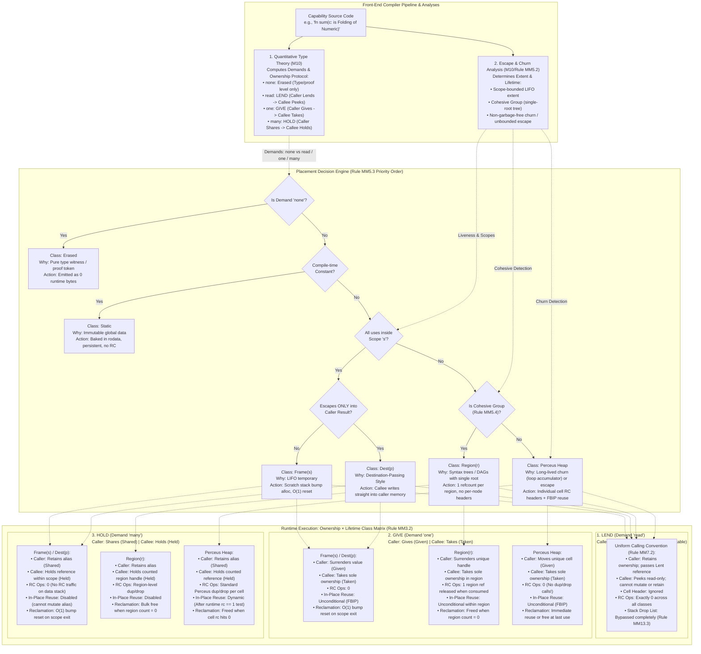
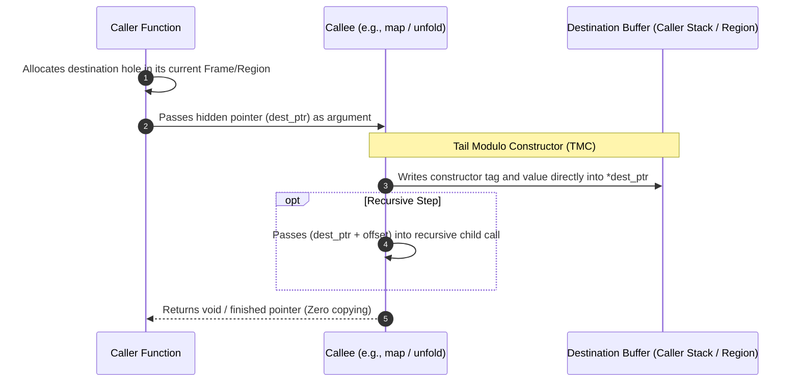
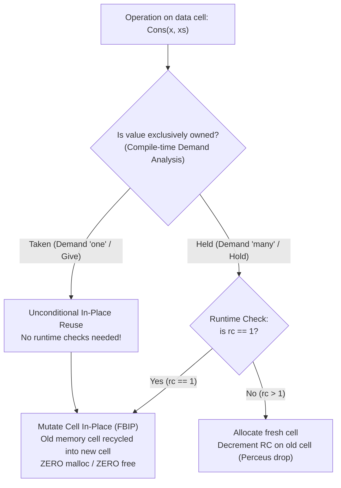
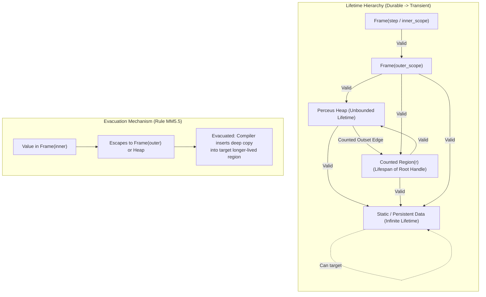
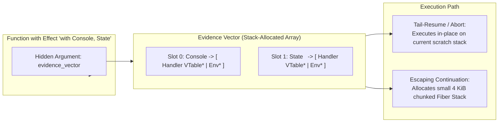
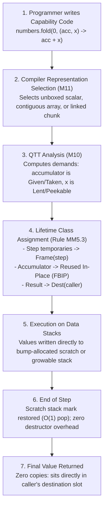

# Fixed: Memory Layouts, Structures, and Value Flow

This document provides a set of architectural Mermaid diagrams illustrating how runtime values are represented, allocated, passed, and reclaimed in **Fixed**.

These diagrams reflect the design specified in:
- [`spec/memory_management.md`](../spec/memory_management.md) (Lifetime classes, regions, Goose-style data stacks, Perceus heap, destinations, FBIP reuse)
- [`spec/quantities.md`](../spec/quantities.md) (Quantitative Type Theory: demands, exclusivity, borrowing)
- [`spec/effects.md`](../spec/effects.md) (Evidence-passing vectors and fiber stacks)

---

## 1. The Two-Axis Placement & Management Matrix

In Fixed, **ownership** (deciding reference-counting traffic and in-place reuse) is strictly decoupled from **lifetime class** (deciding physical storage location). 

Ownership is governed by three fundamental interaction modes, presented in increasing order of commitment: **Lend $\to$ Give $\to$ Hold**.

Source: [`01-quantity-lifetime-matrix.mmd`](01-quantity-lifetime-matrix.mmd)

---

### Caller vs. Callee Ownership Naming

When values cross function call boundaries, the ownership contract is symmetrical yet distinct from the caller's and callee's perspectives:

| Ownership Mode | Demand | Caller Perspective (Action $\to$ State) | Callee Perspective (Action $\to$ State) | Mechanical Consequence |
| :--- | :--- | :--- | :--- | :--- |
| **1. Lend** | `read` | **Lend** $\implies$ Value is **Lent** *(Caller retains ownership; hands over temporary view)* | **Peek** $\implies$ Value is **Peekable** *(Callee observes read-only; cannot mutate or retain)* | **$0$ RC ops** guaranteed across all lifetime classes. Bypasses frame drop lists entirely. |
| **2. Give** | `one` | **Give** $\implies$ Value is **Given** *(Caller relinquishes and moves its unique ownership)* | **Take** $\implies$ Value is **Taken** *(Callee assumes sole ownership; authorized for FBIP)* | **$0$ RC ops**. Callee can destructively mutate and overwrite memory in-place. |
| **3. Hold** | `many` | **Share** $\implies$ Value is **Shared** *(Caller retains an ongoing reference alongside callee)* | **Hold** $\implies$ Value is **Held** *(Callee counts/retains its reference alongside aliases)* | **Perceus RC traffic** (`dup`/`drop`). In-place mutation guarded by runtime `rc == 1` tests. |

---

### How and Why Front-End Analysis Guides Placement Decisions

In **Fixed**, the programmer writes code against **abstract capabilities** (`is Folding of Numeric`). The compiler selects both the data representation and the physical memory placement, guided by two core front-end analyses:

#### 1. Quantitative Type Theory (QTT) Demand Inference (`spec/quantities.md`)
QTT analyses track how many times every variable and witness is consumed across the call graph:
- **Demand `none` (Erased):** The value exists purely at the type or proof level (e.g., capability witnesses, type equality tokens).  
  *Why:* Emitting runtime memory for erased tokens would introduce senseless memory bloat. The compiler eliminates them completely ($0$ bytes).
- **Demand `read` (Lend $\to$ Peek):** The callee inspects or reads the value without capturing it or keeping it alive past the function return.  
  *Why:* Callee code does not increment or decrement reference counts. The caller passes a raw pointer, avoiding all atomic or non-atomic RC traffic.
- **Demand `one` (Give $\to$ Take):** The value has a single, unique owner who consumes it.  
  *Why:* Enables **guaranteed compile-time Functional But In-Place (FBIP) mutation**. When a constructor replaces an old value, the compiler overwrites the dead cell directly without allocating new memory or running an `rc == 1` test.
- **Demand `many` (Share $\to$ Hold):** The value is held by many owners concurrently.  
  *Why:* The runtime must emit reference-count tracking (`dup` / `drop`) and guard in-place mutations behind dynamic `rc == 1` checks.

#### 2. Escape & Extent Analysis (`spec/memory_management.md` §5)
This analysis determines the dynamic lifetime of each value relative to language execution scopes:
- **Scope-Bounded LIFO Extent $\implies$ `Frame(s)` (Scratch Stack):**  
  *How:* The compiler verifies that all uses of an allocation occur within lexical scope $s$ (e.g., a function body, a fold iteration, or an effect handler body).  
  *Why:* Traditional heaps suffer from allocation fragmentation and costly deallocation. Fixed's `Frame(s)` places values on a contiguous, headerless scratch data stack. Allocation is a simple pointer bump, and reclamation is an instant $O(1)$ mark/reset at scope exit.
- **Result-Bounded Escape $\implies$ `Dest(p)` (Destination-Passing):**  
  *How:* The value escapes the current scope, but *only* as the return value flowing into the caller.  
  *Why:* Allocating a return buffer in the callee and copying it back to the caller causes redundant memory moves. Instead, the caller passes a hidden pointer to its own destination memory, and the callee writes directly into it.
- **Cohesive Grouping $\implies$ `Region(r)` (Counted Regions):**  
  *How:* Detects structures (like syntax trees, graph nodes, or ASTs generated by an `unfold`) created within one dynamic extent, rooted in a single handle, where internal elements are dropped together (Rule MM5.4).  
  *Why:* If a 10,000-node AST were placed on the general heap, every node would require an $8-16$ byte reference-counting header, wasting memory. In a `Region(r)`, **only one descriptor and one reference count** exist for the entire tree. Interior pointers need no individual headers, and the entire tree is reclaimed in one stroke when the root count hits zero.
- **Long-Lived Churn & Unbounded Escape $\implies$ `Heap` (Perceus Heap):**  
  *How:* Identifies loop accumulators in `fold`/`unfold` that are *not* garbage-free (Rule MM5.2b), or values that escape into closures/fibers beyond any identifiable scope.  
  *Why (The MLKit Problem):* In early region-based systems (like MLKit), accumulating values across recursive loops in a region leaked memory until the loop completed, exhausting memory. Fixed identifies non-garbage-free churn and routes those carried values to the `Heap`, allowing Perceus to free each iteration's dead version immediately as it dies.

---

## 2. Runtime Memory Topography: Stacks and Regions

Fixed structures memory into chunked regions ($4\text{ KiB} \to 8\text{ KiB} \to 16\text{ KiB}$ exponential doubling) without large address-space reservations:
- **Scratch Stack**: Headerless, strictly LIFO per scope. Instant bump-pointer reset at scope exit.
- **Growable Stacks**: Dedicated to values under construction (contiguous arrays / packed blobs) so loop scratch doesn't block contiguous growth.
- **Counted Regions**: One descriptor and count per cohesive group (e.g. syntax trees). Interior pointers need no individual headers.
- **Perceus Heap**: Header per cell with RC for long-lived shared churn.

Source: [`02-runtime-memory-topography.mmd`](02-runtime-memory-topography.mmd)

```mermaid
flowchart TB
    subgraph ExecutionLane["Thread / Fiber / Lane Execution Context"]
        direction TB

        subgraph ScratchStack["1. Scratch Data Stack (LIFO per Scope)"]
            OuterFrame["Frame(outer_scope)\nHeaderless values, no RC operations"]
            ScopeMark["Mark (chunk_id, offset)"]
            InnerFrame["Frame(step / inner_scope)\nPer-step temporaries in fold/unfold"]
            ScopeExit["Scope Exit -> Instant Bump-Pointer Reset\n(No per-value free; drop list walked only for owned heap refs)"]
            OuterFrame --- ScopeMark
            ScopeMark --- InnerFrame
            InnerFrame -.->|LIFO Reset| ScopeMark
        end

        subgraph GrowableStack["2. Growable Stacks (N Stacks)"]
            GrowableVal["Contiguous Value Under Construction\n(Contiguous Array or Packed Blob)"]
            NoteGrow["Separated from scratch stack!\nPrevents loop scratch from blocking contiguous growth.\nDoubles chunk and relocates if capacity exceeded."]
        end

        subgraph CountedRegion["3. Counted Regions: Region(r)"]
            RegHeader["Region Descriptor\n[ Total Refcount | Outset Edges {q1, q2} ]"]
            C1["Chunk 0 (4 KiB)"]
            C2["Chunk 1 (8 KiB)"]
            C3["Chunk 2 (16 KiB)"]
            RegHeader --> C1
            C1 --> C2
            C2 --> C3
            NoteCR["No headers on individual cells!\nInterior pointers are masked to find descriptor.\nEntire tree freed in one stroke when count reaches 0."]
        end

        subgraph PerceusHeap["4. Perceus Heap"]
            HeapCell1["Heap Cell [Header: RC, Tag] | Payload"]
            HeapCell2["Heap Cell [Header: RC, Tag] | Payload"]
            ReusePool["Reused in-place via FBIP"]
        end
    end
```

---

## 3. Destination-Passing Style (`Dest(p)`)

Callers reserve a destination hole and pass a hidden pointer down the call chain. Constructors in tail position write directly into caller memory (Tail Modulo Constructor), eliminating intermediate allocations.

Source: [`03-destination-passing-style.mmd`](03-destination-passing-style.mmd)

---

## 4. Functional But In-Place (FBIP) & Perceus Reuse

Data transformations recycle dead memory cells without calling allocators:
- **Taken (Demand 'one' / Give)**: In-place mutation is guaranteed at compile time without runtime checks.
- **Held (Demand 'many' / Hold)**: Runtime `rc == 1` test unlocks in-place mutation; branches to fresh allocation only when truly shared.

Source: [`04-fbip-perceus-reuse.mmd`](04-fbip-perceus-reuse.mmd)

---

## 5. Region-Containment Invariant & Evacuation

Fixed enforces Rule MM4.1: $\text{lifetime}(\text{Target}) \supseteq \text{lifetime}(\text{Source})$. If an inner value escapes into a longer-lived context, the compiler automatically inserts an **evacuation** (deep copy) into the outer region or heap.

Source: [`05-region-containment-evacuation.mmd`](05-region-containment-evacuation.mmd)

---

## 6. Algebraic Effects: Evidence Vectors and Fiber Stacks

Effects compile to hidden evidence vectors. Tail-resuming handlers execute directly on the current scratch stack. Small chunked fiber stacks ($4\text{ KiB}$) are created only when non-tail continuations escape.

Source: [`06-effects-evidence-fibers.mmd`](06-effects-evidence-fibers.mmd)

---

## 7. End-to-End Value Lifecycle in Fixed

Source: [`07-value-lifecycle-journey.mmd`](07-value-lifecycle-journey.mmd)

